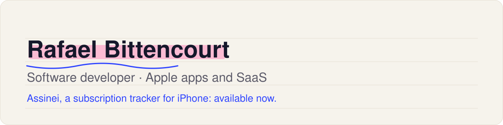

I build Apple apps and SaaS products, working with Claude Code. I came to software from business administration, video and digital marketing, and I learned by shipping real products.

## Available now

### [Assinei](https://apps.apple.com/app/apple-store/id6824557446?pt=96493818&ct=github&mt=8) · iPhone app

Shows how much you pay per month and per year in subscriptions, and reminds you before every charge, including boleto and Pix bills. Everything stays on the device: no account, no bank connection, no third-party SDKs.

- [Download on the App Store](https://apps.apple.com/app/apple-store/id6824557446?pt=96493818&ct=github&mt=8) (free)
- [Help and privacy policy](https://rafabittt.github.io/assinei/) (Portuguese)
- [Instagram @assinei.app](https://www.instagram.com/assinei.app/)

### [How to cancel](https://github.com/rafabittt/como-cancelar) · open list

An open list, checked every week, of the official cancellation pages for the most used subscription services in Brazil: Contributions welcome: [rafabittt/como-cancelar](https://github.com/rafabittt/como-cancelar).

## What I write about

- What it is like to build a native app with Claude Code, from the `CLAUDE.md` to the App Store.
- Product rules that are hard in Brazil: boleto, Pix, currency exchange with IOF tax, the 13th salary.
